# P1/P2 same-source renderer comparison

Status: **fresh writing not accepted; independent visual review pending; feature disabled**.

These are explicitly synthetic review images. Every pair shows the golden
reference on the left and the product renderer on the right. The comparison
contains all five Charter pages and all sixteen Discovery slides.

## Benchmark Boundary

This is a renderer comparison, not a fresh AI-generation acceptance. Seventeen
input files were hash-verified, the reviewed golden narrative was frozen, and
twenty-four chart values were read from its supplied CSV. Both outputs use the
product export code. The Charter retains only its five phase-correct sources;
later findings are not retroactively inserted.

No database, tenant upload, approval or workflow dispatch occurred. The frozen
comparison involves no model call; the separate fresh experiment below does.
Source files, manifests, original artifact identifiers and editable reference
files are not included in this public record.

## What To Review

Compare type, composition, page-specific scope, source labels, table readability,
role treatment and the blank authorization record. The native exports are
available in the local review package.

The refined renderer adds semantic labelled statements, labelled conclusions,
display-size figures, horizontal chart categories and unit captions, shared-attribute
comparison tables, and purpose-grouped sources with use/limitation columns.
The Charter preserves title hierarchy, bold lead-ins, decision guidance and grouped
citations. This is not a 55% area-fill pass. Automatic sparse-page merging and raster
repair remain open.

The rendered images were inspected using bundled LibreOffice output, not native
PowerPoint acceptance. No fidelity score or quality approval is asserted.

## Fresh Writing Verdict

The new offline experiment supplies raw-source extracts to Anthropic with no
golden prose. It produces a seven-page Charter and twenty-three-slide readout for
each of two synthetic scenarios. These are review candidates, not approved outputs.
The first scenario's related-topic comparison is linked below; there is no golden
reference for the second scenario.

Fresh writing **does not pass acceptance**. It can restate an earlier phase request
instead of synthesizing a readout decision, infer historical absence from a planned
evidence status, repeat action pages and overuse disclaimers. Sparse Charter/table
continuations and unformatted numeric slots also remain. Passing geometry and exact
numeric-slot checks do not establish claim correctness or executive readability.

The first scenario uses five phase-correct Charter inputs and seventeen Discovery
files. The second uses one Charter brief and eight Discovery files, with only the
large baseline workbook's Summary worksheet supplied to the model. A separate
full-cohort reconciliation is not evidence that the model consumed omitted sheets.
The local proof includes coverage, source hashes, response hashes and failed attempts.

This is not the production orchestration, retrieval, upload or signed-in export path.
No source is promoted to agent-ready status. The flag remains disabled pending
writing fixes, independent page-by-page acceptance and production-path validation.

[Fresh writing related-topic pairs](Fresh_Comparisons.md)

## Charter

P1 01: golden reference / product export

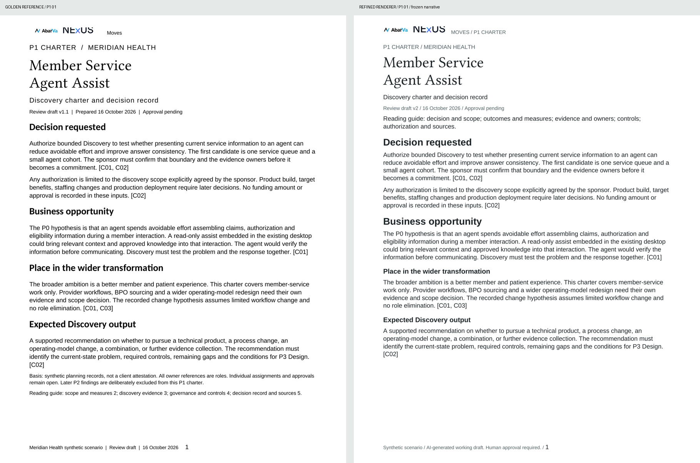

[Open full-resolution PNG](images/P1-01-comparison.png)

P1 02: golden reference / product export

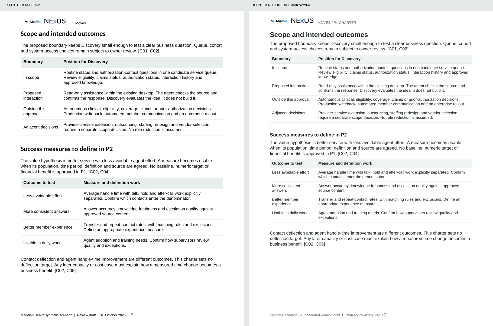

[Open full-resolution PNG](images/P1-02-comparison.png)

P1 03: golden reference / product export

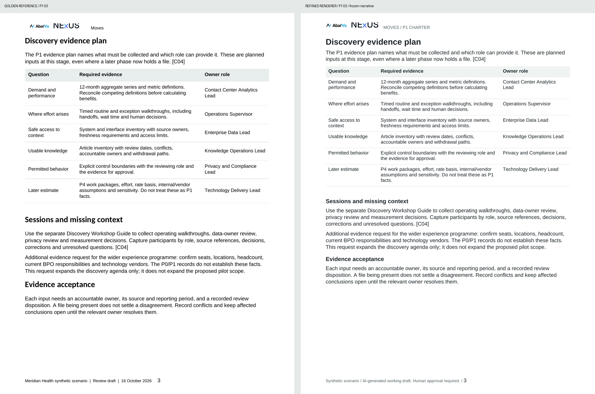

[Open full-resolution PNG](images/P1-03-comparison.png)

P1 04: golden reference / product export

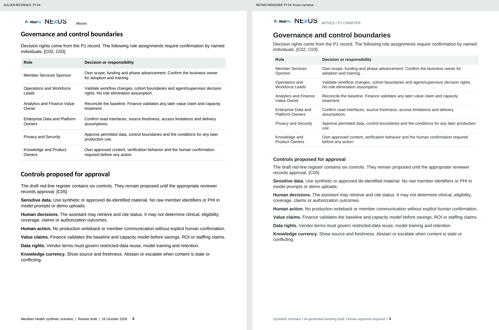

[Open full-resolution PNG](images/P1-04-comparison.png)

P1 05: golden reference / product export

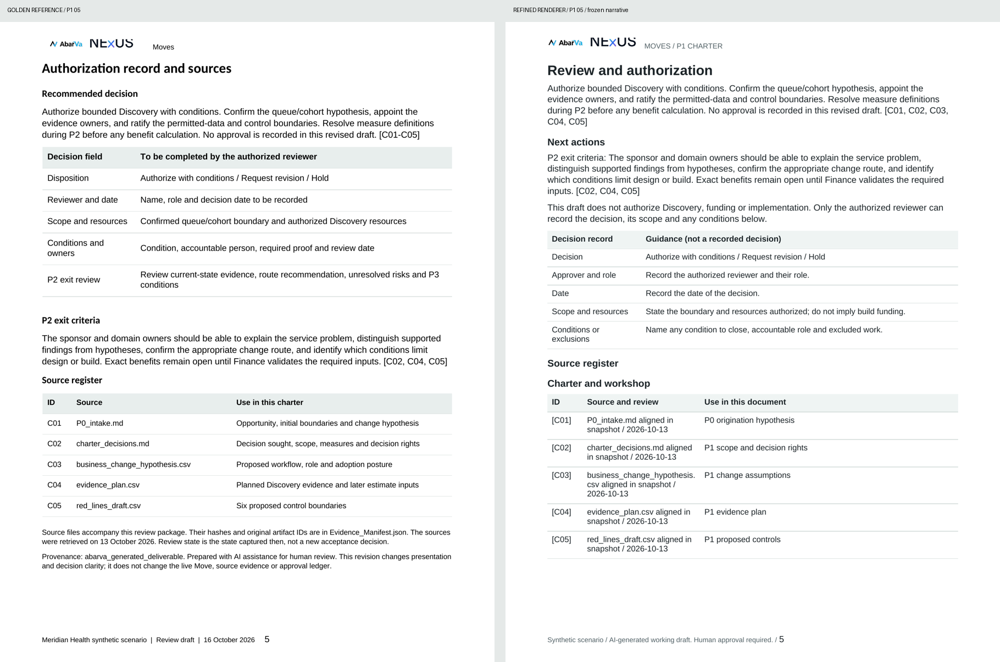

[Open full-resolution PNG](images/P1-05-comparison.png)

## Discovery

P2 01: golden reference / product export

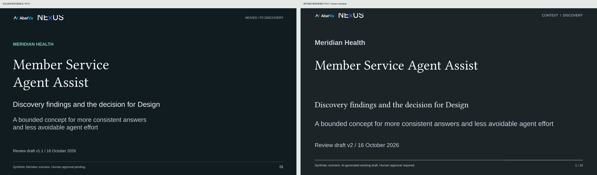

[Open full-resolution PNG](images/P2-01-comparison.png)

P2 02: golden reference / product export

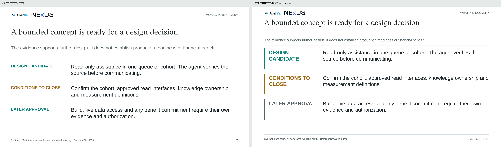

[Open full-resolution PNG](images/P2-02-comparison.png)

P2 03: golden reference / product export

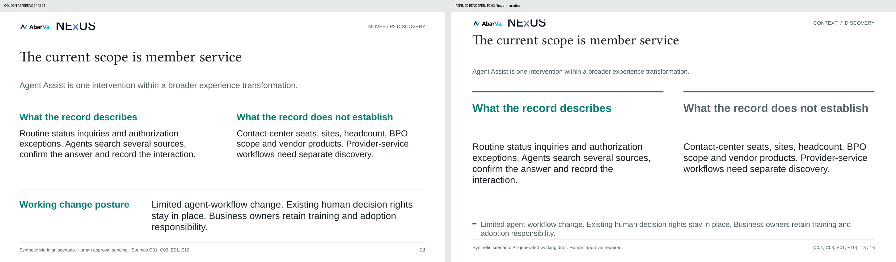

[Open full-resolution PNG](images/P2-03-comparison.png)

P2 04: golden reference / product export

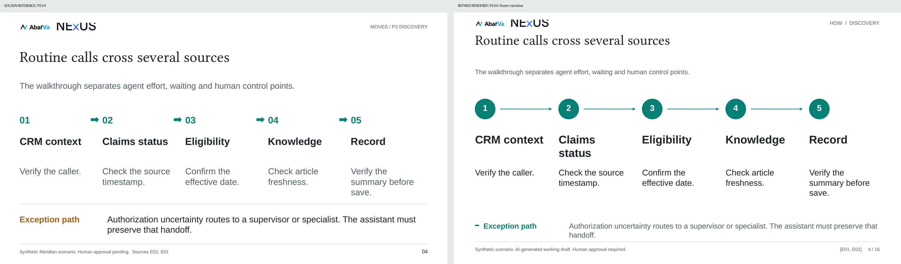

[Open full-resolution PNG](images/P2-04-comparison.png)

P2 05: golden reference / product export

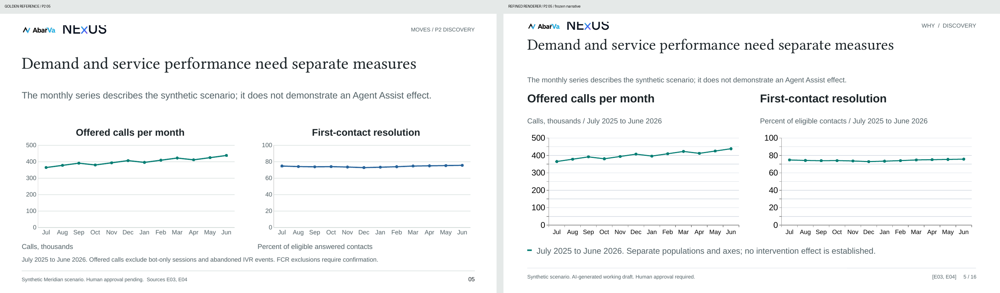

[Open full-resolution PNG](images/P2-05-comparison.png)

P2 06: golden reference / product export

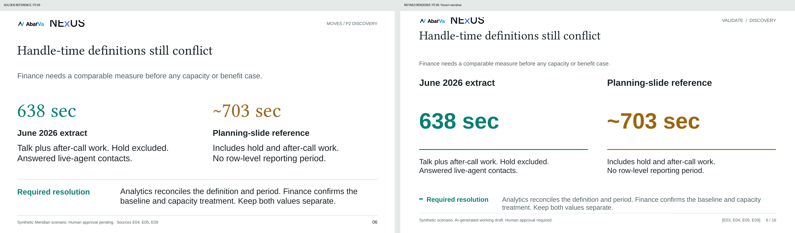

[Open full-resolution PNG](images/P2-06-comparison.png)

P2 07: golden reference / product export

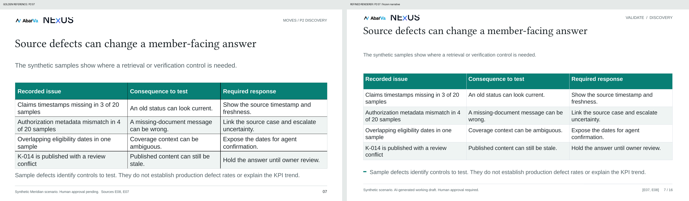

[Open full-resolution PNG](images/P2-07-comparison.png)

P2 08: golden reference / product export

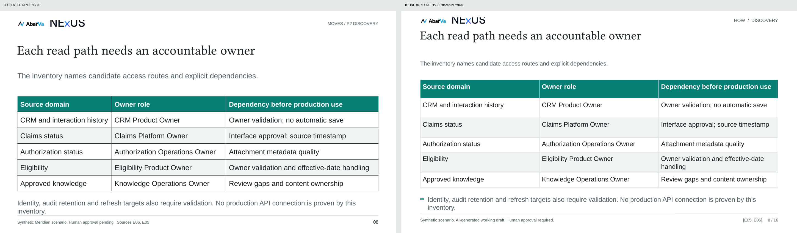

[Open full-resolution PNG](images/P2-08-comparison.png)

P2 09: golden reference / product export

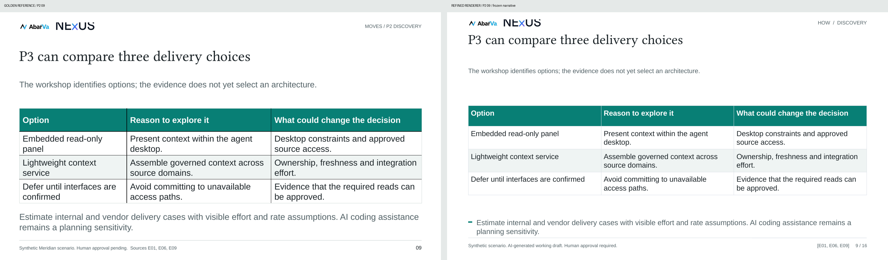

[Open full-resolution PNG](images/P2-09-comparison.png)

P2 10: golden reference / product export

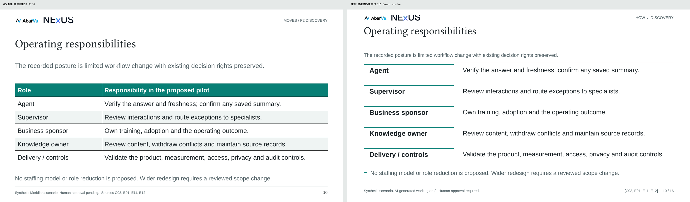

[Open full-resolution PNG](images/P2-10-comparison.png)

P2 11: golden reference / product export

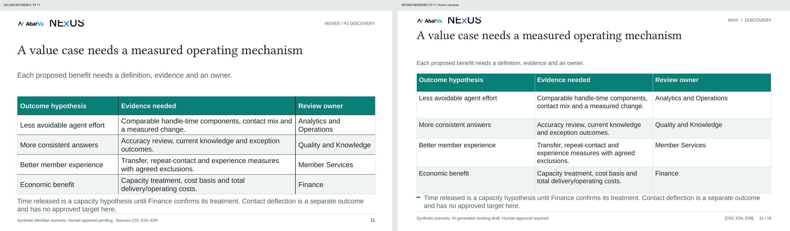

[Open full-resolution PNG](images/P2-11-comparison.png)

P2 12: golden reference / product export

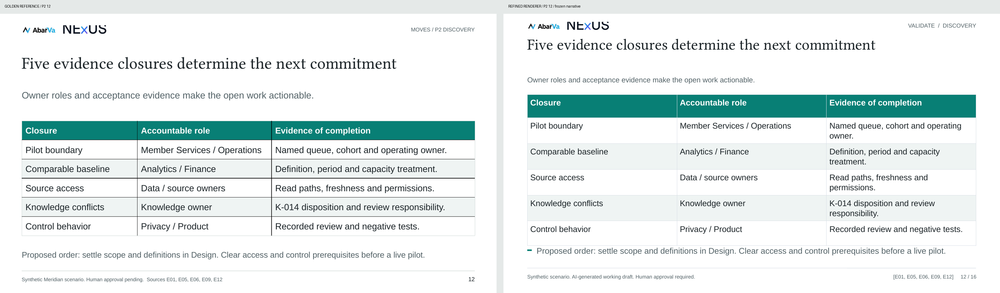

[Open full-resolution PNG](images/P2-12-comparison.png)

P2 13: golden reference / product export

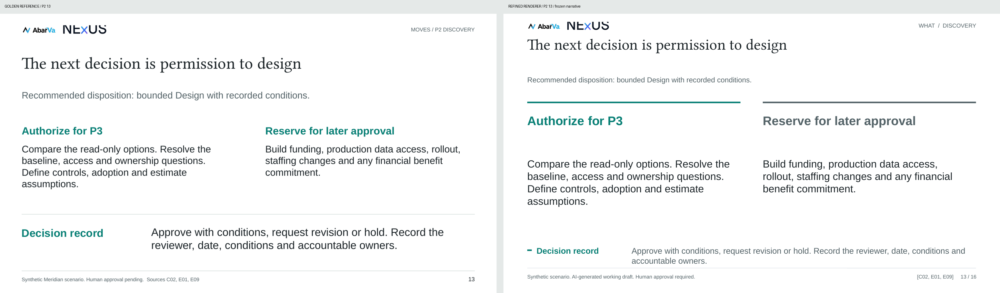

[Open full-resolution PNG](images/P2-13-comparison.png)

P2 14: golden reference / product export

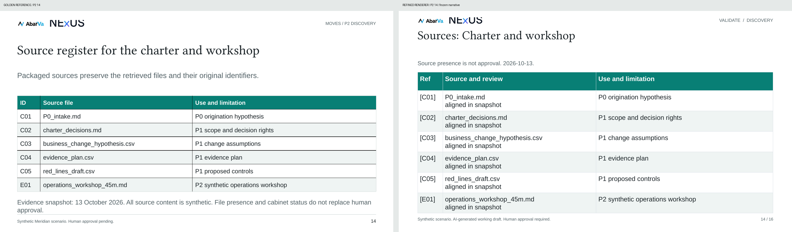

[Open full-resolution PNG](images/P2-14-comparison.png)

P2 15: golden reference / product export

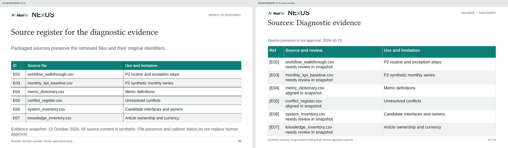

[Open full-resolution PNG](images/P2-15-comparison.png)

P2 16: golden reference / product export

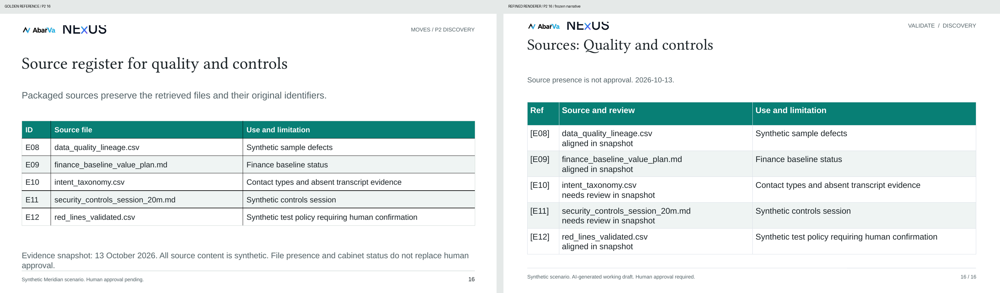

[Open full-resolution PNG](images/P2-16-comparison.png)

